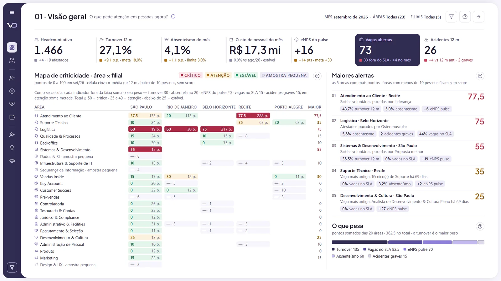

# People Analytics

**O que pede atenção em pessoas agora?**

Painel Power BI de demonstração da Vizu Dados, com dados fictícios.

*Pessoas · rotatividade, ausência e clima*

## O que ele mostra
- Headcount
- Turnover
- Absenteísmo
- eNPS
- Mapa de criticidade

## Ver o painel
- [Abrir o painel interativo](https://app.powerbi.com/view?r=eyJrIjoiODg5NmE4ZmYtYWZlNS00ODM0LTliNjMtMWIyNjhhMjA5ZTk0IiwidCI6IjQ3ZWU2OTdmLWVkNDctNDY2Ni1hNzk2LTJjMTBhNzI2MDMzNCJ9&pageName=Capa)
- [Todos os painéis em vizudados.com.br](https://vizudados.com.br/power-bi#people-analytics)

Este repositório também guarda as mídias da capa do painel.

© Vizu Dados
